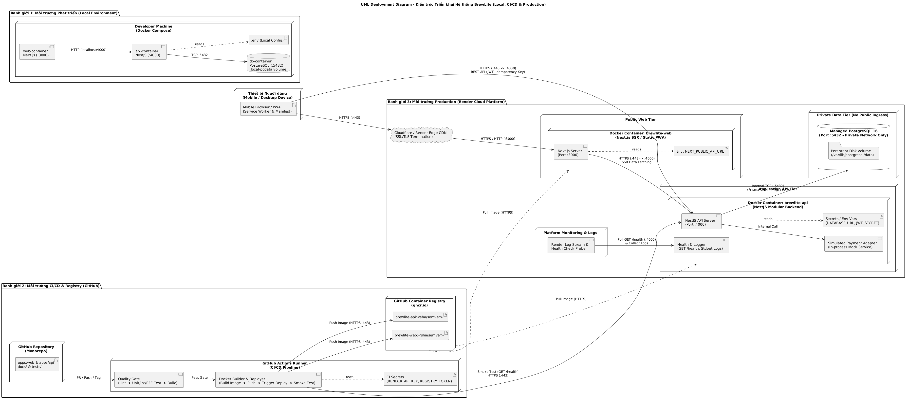

# Thiết kế Triển khai và Vận hành Hệ thống (Task 3.2)

Tài liệu này mô tả chi tiết sơ đồ triển khai (Deployment Diagram) của hệ thống **BrewLite** trên 3 môi trường (**Local**, **CI/CD**, **Production**) và bảng ánh xạ truy vết từng container/dịch vụ về kiến trúc và mã nguồn[cite: 5, 8].

## 1. Sơ đồ Triển khai (UML Deployment Diagram)
- **Tệp nguồn:** `docs/diagrams/deployment-production.puml`
- **Tệp kết xuất:** `docs/diagrams/deployment-production.png`[cite: 5]

---

## 2. Phân tách Ranh giới các Môi trường (Environment Boundaries)

### 2.1. Môi trường Local (Docker Compose)
- Lập trình viên khởi chạy toàn bộ hệ thống thông qua tệp `docker-compose.yml` ở thư mục gốc[cite: 7, 8].
- Bao gồm 3 container chạy trong cùng mạng nội bộ Docker (`brewlite-net`):
  1. `web-container`: Chạy ứng dụng Next.js tại cổng `3000`[cite: 5, 7].
  2. `api-container`: Chạy ứng dụng NestJS tại cổng `4000`, tự động chạy migration/seed khi khởi động[cite: 5, 7].
  3. `db-container`: Chạy PostgreSQL 16 tại cổng `5432` gắn kèm Docker Volume (`local-pgdata`) để giữ dữ liệu khi tắt máy[cite: 5, 7].
- Biến môi trường được nạp từ tệp `.env` (tạo từ bản mẫu `.env.example`, không commit tệp `.env` lên Git)[cite: 6, 7, 8].

### 2.2. Môi trường CI/CD & Container Registry (GitHub Actions + GHCR)
- **Continuous Integration (Khi mở Pull Request):** GitHub Actions tự động kéo mã nguồn, cài đặt thư viện, chạy `Lint -> Unit Test -> Integration/E2E Test -> Build`[cite: 6, 7]. Nếu bất kỳ bước nào lỗi, PR sẽ bị chặn merge[cite: 6].
- **Continuous Delivery/Deployment (Khi Push vào `main` hoặc tạo Tag Release):**
  1. Đóng gói Docker Image cho `apps/web` và `apps/api` với nhãn (tag) theo mã commit SHA (`sha-xxxxxxx`) hoặc Semantic Version (`v1.0.0`)[cite: 7, 8].
  2. Đẩy (Push) cả 2 image lên **GitHub Container Registry (`ghcr.io`)**[cite: 5, 7].
  3. Kích hoạt triển khai (Deploy) lên **Render Cloud** thông qua khóa bí mật lưu trong **GitHub Secrets**[cite: 5, 7].
  4. Thực thi `prisma migrate deploy` an toàn trước khi khởi chạy phiên bản API mới[cite: 5, 7].
  5. Gọi kiểm tra tự động **Smoke Test** vào địa chỉ `GET https://<api-domain>/health`[cite: 5, 7]. Nếu thất bại, pipeline báo lỗi và thực hiện quy trình **Rollback** về image tag ổn định liền trước[cite: 7].

### 2.3. Môi trường Production (Render Cloud Platform)
- **Giao thức & Bảo mật mạng:** Người dùng cuối truy cập qua giao thức **HTTPS (Port 443)** được cấp chứng chỉ SSL/TLS tự động qua lớp CDN/Edge của nền tảng[cite: 5, 7].
- **Cô lập Cơ sở dữ liệu:** Dịch vụ **PostgreSQL Production** gắn kèm ổ đĩa lưu trữ bền vững (**Persistent Storage Volume**) và chỉ mở cổng `5432` trong mạng nội bộ (**Private Network**), tuyệt đối không cho phép truy cập trực tiếp từ Internet[cite: 5, 7].
- **Quản lý Secret, Health Check & Log:**
  - Các thông tin nhạy cảm (`DATABASE_URL`, `JWT_SECRET`) được cấu hình trong mục **Environment Secrets** của Render, không xuất hiện trong mã nguồn hay log CI[cite: 5, 7].
  - Hệ thống nền tảng định kỳ gọi `GET /health` (cổng nội bộ `4000`) để giám sát trạng thái hoạt động và thu thập toàn bộ luồng log (`stdout`/`stderr`) phục vụ tra cứu lỗi[cite: 5, 7].

---

## 3. Bảng Truy vết Thành phần Triển khai (Deployment Traceability)

Bảng dưới đây chứng minh tính nhất quán giữa **Deployment Diagram**, **Mô tả Kiến trúc (Task 3.1)** và **Cấu trúc Mã nguồn (Repository)**[cite: 5, 8]:

| Node / Container trên Deployment Diagram | Thành phần trong Mô tả Kiến trúc (Task 3.1) | Đường dẫn trong Mã nguồn (Repository) | Giao thức & Cổng (Port) |
| :--- | :--- | :--- | :--- |
| `Mobile Browser / PWA` | Client Tier (Thiết bị người dùng)[cite: 5] | `apps/web/public/manifest.json` | HTTPS (`:443`)[cite: 5] |
| `Docker Container: brewlite-web` | Presentation Tier – Next.js Mobile-first/PWA[cite: 5] | `apps/web/` (`apps/web/Dockerfile`)[cite: 8] | HTTPS (`:443` $\rightarrow$ `:3000`)[cite: 5] |
| `Docker Container: brewlite-api` | Application / API Tier – NestJS Modular Backend[cite: 5] | `apps/api/` (`apps/api/Dockerfile`)[cite: 8] | HTTPS (`:443` $\rightarrow$ `:4000`)[cite: 5] |
| `Simulated Payment Adapter` | External / Simulated Tier – Dịch vụ thanh toán mô phỏng[cite: 5] | `apps/api/src/payments/`[cite: 8] | Gọi nội bộ trong tiến trình API |
| `Health & Logger` | Logging & Health Check (`HealthModule`)[cite: 5] | `apps/api/src/health/` (`GET /health`)[cite: 7, 8] | HTTP/HTTPS (`:4000` / `:443`)[cite: 5, 7] |
| `Managed PostgreSQL 16 (Persistent Disk)` | Data Tier – PostgreSQL & Cơ chế Migration[cite: 5] | `apps/api/prisma/schema.prisma` & `migrations/`[cite: 7, 8] | TCP nội bộ (`:5432` - Private)[cite: 5, 7] |
| `GitHub Actions Runner` & `GHCR` | Pipeline CI/CD & Container Registry[cite: 5, 6, 7] | `.github/workflows/ci.yml` & `cd.yml`[cite: 8] | HTTPS (`:443`)[cite: 5] |
| `Developer Machine (Docker Compose)` | Môi trường Local tái tạo toàn hệ thống[cite: 5, 7] | `docker-compose.yml` & `.env.example`[cite: 7, 8] | HTTP (`:3000`, `:4000`), TCP (`:5432`)[cite: 5, 7] |