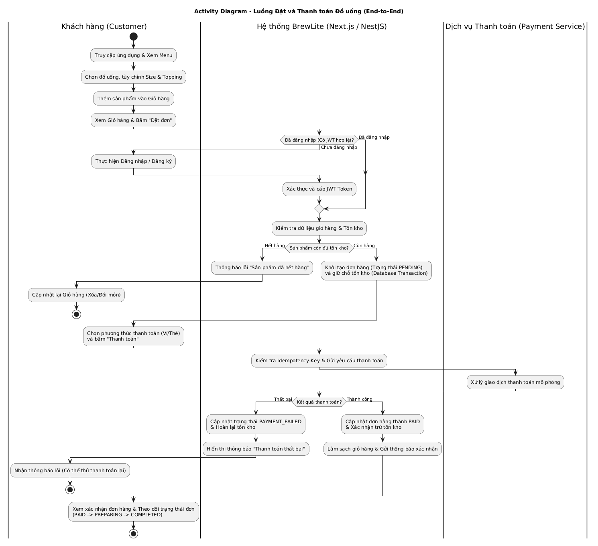
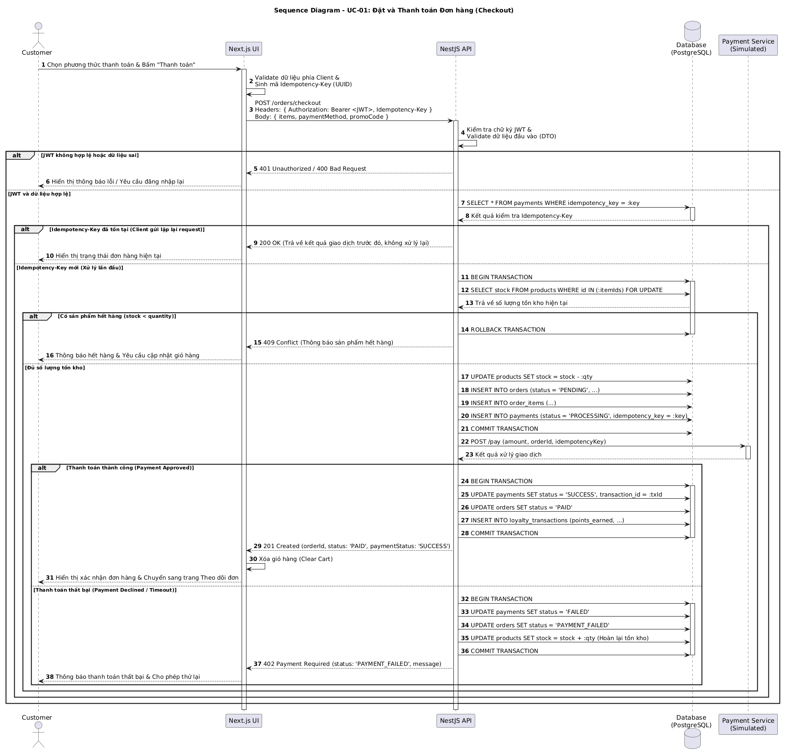
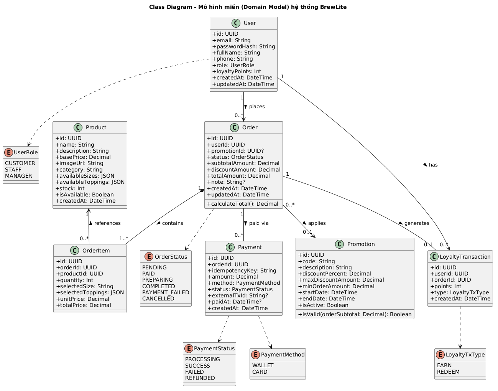

# Mô hình hóa Hệ thống (System Modeling - Task 2)

Tài liệu này tổng hợp các sơ đồ UML mô hình hóa hệ thống **BrewLite** ở Task 2, đảm bảo tính nhất quán hoàn toàn với SRS và đặc tả Use-case ở Task 1[cite: 3, 5].

## 1. Activity Diagram – Luồng nghiệp vụ End-to-End (Task 2.1)
- **Tệp nguồn:** `docs/diagrams/activity-end-to-end.puml`
- **Tệp kết xuất:** `docs/diagrams/activity-end-to-end.png`[cite: 5]
- **Mô tả:** Thể hiện toàn bộ luồng nghiệp vụ từ khi khách hàng xem menu, chọn size/topping, thêm vào giỏ hàng, kiểm tra đăng nhập, kiểm tra tồn kho đến thanh toán và theo dõi đơn[cite: 3, 4]. Bao gồm đầy đủ các nhánh xử lý lỗi: chưa đăng nhập, hết hàng và thanh toán thất bại[cite: 4].

---

## 2. Sequence Diagram – Đặt và Thanh toán Đơn hàng (Task 2.2)
- **Tệp nguồn:** `docs/diagrams/sequence-checkout.puml`[cite: 5]
- **Tệp kết xuất:** `docs/diagrams/sequence-checkout.png`[cite: 5]
- **Mô tả:** Thể hiện chi tiết tương tác giữa 5 lifeline (`Customer` -> `Next.js UI` -> `NestJS API` -> `Database` -> `Payment Service`)[cite: 4]. Bao gồm xác thực JWT, kiểm tra `Idempotency-Key` chống thanh toán trùng lặp, quản lý Database Transaction khi tạo đơn/cập nhật tồn kho, và rẽ nhánh `alt` cho kịch bản thanh toán thành công/thất bại[cite: 4].

---

## 3. Class Diagram – Mô hình lớp mức Domain (Task 2.3)
- **Tệp nguồn:** `docs/diagrams/class-domain.puml`[cite: 5]
- **Tệp kết xuất:** `docs/diagrams/class-domain.png`[cite: 5]
- **Mô tả:** Biểu diễn 7 lớp thực thể cốt lõi của miền nghiệp vụ (`User`, `Product`, `Order`, `OrderItem`, `Payment`, `Promotion`, `LoyaltyTransaction`) cùng các thuộc tính, kiểu liệt kê trạng thái (`enum`), quan hệ và bội số (`multiplicity`)[cite: 5].

