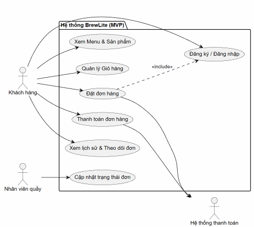

# Tài liệu Đặc tả Yêu cầu Hệ thống (SRS) - BrewLite

## 1. Sơ đồ Use-case tổng quát
Sơ đồ dưới đây thể hiện các tác nhân (Actor) và các ca sử dụng (Use-case) chính của hệ thống trong phạm vi MVP[cite: 4].

Mã nguồn PlantUML của sơ đồ (`docs/diagrams/use-case-tong-quat.puml`):

    @startuml
    left to right direction
    actor "Khách hàng" as Customer
    actor "Nhân viên quầy" as Staff
    actor "Hệ thống thanh toán" as PaymentService

    package "Hệ thống BrewLite (MVP)" {
      usecase "Xem Menu & Sản phẩm" as UC1
      usecase "Quản lý Giỏ hàng" as UC2
      usecase "Đăng ký / Đăng nhập" as UC3
      usecase "Đặt đơn hàng" as UC4
      usecase "Thanh toán đơn hàng" as UC5
      usecase "Xem lịch sử & Theo dõi đơn" as UC6
      usecase "Cập nhật trạng thái đơn" as UC7
    }

    Customer --> UC1
    Customer --> UC2
    Customer --> UC3
    Customer --> UC4
    Customer --> UC5
    Customer --> UC6

    UC4 ..> UC3 : <<include>>
    UC4 --> PaymentService
    UC5 --> PaymentService

    Staff --> UC7
    @enduml

---

## 2. Yêu cầu Chức năng (Functional Requirements - FR)

Đề bài yêu cầu bao phủ tối thiểu 8 nhóm chức năng: menu, chi tiết sản phẩm, giỏ hàng, xác thực, đặt đơn, thanh toán, lịch sử đơn và quản lý trạng thái đơn[cite: 4].

| Mã ID | Nhóm tính năng | Tên yêu cầu | MoSCoW | Tiêu chí chấp nhận (Acceptance Criteria) |
| :--- | :--- | :--- | :---: | :--- |
| **FR-01** | Menu | Xem danh sách đồ uống | Must | - Hiển thị danh sách sản phẩm lấy từ API `GET /products`[cite: 6]. - Giao diện xử lý đủ 3 trạng thái: `loading` (đang tải), `empty` (danh sách trống) và `error` (lỗi kết nối)[cite: 6]. |
| **FR-02** | Chi tiết sản phẩm | Xem chi tiết, chọn size và topping | Must | - Lấy thông tin chi tiết món qua API `GET /products/:id`[cite: 6]. - Cho phép chọn kích cỡ (Size S/M/L) và các loại Topping đi kèm[cite: 6]. - Đơn giá tự động cộng thêm phụ phí khi thay đổi size/topping. |
| **FR-03** | Giỏ hàng | Quản lý giỏ hàng và tính tổng tiền | Must | - Cho phép thêm món (kèm tùy chọn size/topping), tăng/giảm số lượng hoặc xóa món khỏi giỏ hàng[cite: 6]. - Hệ thống tự động tính và hiển thị chính xác tổng tiền tạm tính của toàn bộ giỏ hàng[cite: 6]. |
| **FR-04** | Xác thực | Đăng ký, đăng nhập và cấp JWT | Must | - Cho phép tạo tài khoản mới và đăng nhập bằng email/mật khẩu[cite: 6]. - Cấp Access Token (JWT) khi đăng nhập hợp lệ; trả về lỗi `401 Unauthorized` nếu sai thông tin[cite: 4, 6]. |
| **FR-05** | Đặt đơn | Tạo đơn hàng và kiểm tra tồn kho | Must | - Kiểm tra tính hợp lệ của dữ liệu giỏ hàng và xác thực JWT trước khi tạo đơn[cite: 4, 6]. - Sử dụng **Database Transaction** để vừa tạo bản ghi đơn hàng vừa trừ số lượng tồn kho[cite: 4]. - Trả về lỗi `400 Bad Request` và hủy transaction nếu có bất kỳ sản phẩm nào hết hàng[cite: 4]. |
| **FR-06** | Thanh toán | Thanh toán qua Ví/Thẻ mô phỏng | Must | - Gửi yêu cầu thanh toán đến dịch vụ Payment Service mô phỏng[cite: 5, 6]. - Bắt buộc kiểm tra `Idempotency-Key` để đảm bảo không tạo giao dịch hoặc trừ tiền trùng lặp khi client gửi lại request[cite: 4]. - Cập nhật trạng thái đơn thành `PAID` nếu thành công, hoặc `PAYMENT_FAILED` nếu thất bại[cite: 4]. |
| **FR-07** | Quản lý trạng thái đơn | Theo dõi trạng thái đơn hàng | Must | - Khách hàng xem được trạng thái hiện tại của đơn hàng theo luồng: `PENDING` (Chờ thanh toán/xác nhận) $\rightarrow$ `PAID` (Đã thanh toán) $\rightarrow$ `PREPARING` (Đang pha chế) $\rightarrow$ `COMPLETED` (Hoàn thành) hoặc `CANCELLED` (Đã hủy)[cite: 3, 4, 6]. |
| **FR-08** | Lịch sử đơn | Xem lịch sử các đơn đã đặt | Should | - Hiển thị danh sách các đơn hàng thuộc về người dùng đang đăng nhập (sắp xếp từ mới nhất đến cũ nhất)[cite: 4, 6]. - Xem được chi tiết từng đơn (danh sách món, size/topping, tổng tiền, trạng thái, thời gian đặt)[cite: 6]. |
| **FR-09** | Quản lý trạng thái đơn | Nhân viên cập nhật trạng thái đơn | Must | - Nhân viên quầy có thể chuyển trạng thái đơn hàng từ `PAID` sang `PREPARING` và `COMPLETED` khi pha chế xong[cite: 3, 4]. |
| **FR-10** | Khuyến mãi & Tích điểm | Áp dụng mã giảm giá và tích điểm | Could | - Cho phép kiểm tra mã khuyến mãi (`Promotion`) và ghi nhận điểm thưởng (`LoyaltyTransaction`) sau khi đơn hàng hoàn tất (thuộc phạm vi mở rộng)[cite: 3, 5]. |

---

## 3. Yêu cầu Phi chức năng (Non-Functional Requirements - NFR)

Đề bài yêu cầu bao phủ tối thiểu 4 nhóm phi chức năng: hiệu năng, bảo mật, tính khả dụng và khả năng triển khai[cite: 4].

| Mã ID | Nhóm yêu cầu | Tên yêu cầu | MoSCoW | Tiêu chí chấp nhận (Acceptance Criteria) |
| :--- | :--- | :--- | :---: | :--- |
| **NFR-01** | Hiệu năng (Performance) | Thời gian phản hồi API | Should | - Thời gian phản hồi của các API đọc dữ liệu (`GET /products`, `GET /health`) đạt dưới 500ms trong điều kiện tải thông thường. |
| **NFR-02** | Bảo mật (Security) | Xác thực JWT, bảo vệ dữ liệu & Secret | Must | - Tất cả các API đặt đơn, thanh toán, lịch sử đơn phải kiểm tra JWT hợp lệ[cite: 4, 6]. - Validate dữ liệu đầu vào ở cả Frontend và Backend[cite: 6]. - Cơ sở dữ liệu Production không được public trực tiếp ra Internet; không để lộ secret/mật khẩu trong Git hoặc log CI/CD[cite: 7]. |
| **NFR-03** | Tính khả dụng (Availability & Usability) | Giao diện Mobile-first/PWA & Health Check | Must | - Frontend Next.js thiết kế chuẩn Mobile-first, tương thích màn hình di động và hỗ trợ cấu hình PWA[cite: 3, 6]. - Backend cung cấp endpoint `GET /health` trả về HTTP `200 OK` để phục vụ kiểm tra trạng thái hệ thống tự động[cite: 7]. |
| **NFR-04** | Khả năng triển khai (Deployability) | Đóng gói Docker & Tự động hóa CI/CD | Must | - Có tệp `docker-compose.yml` khởi chạy đồng bộ Web, API và PostgreSQL ở môi trường local kèm script migration/seed tái tạo được DB[cite: 7]. - Thiết lập CI/CD tự động chạy Lint, Test, Build, đóng gói Docker Image, đẩy lên Registry, Deploy lên Production qua HTTPS và có cơ chế Rollback khi lỗi[cite: 6, 7]. |