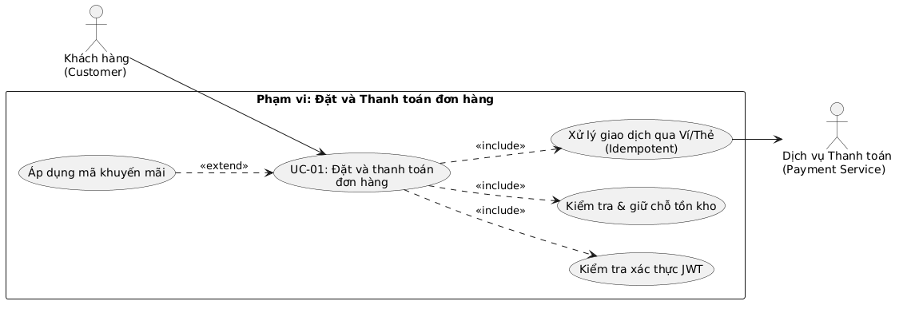

# Đặc tả Use-case Trọng tâm: Đặt và Thanh toán đơn hàng (UC-01)

## 1. Sơ đồ Use-case trong phạm vi Đặt và Thanh toán
Sơ đồ dưới đây mô tả chi tiết phạm vi của ca sử dụng trọng tâm **UC-01: Đặt và thanh toán đơn hàng** cùng các ca sử dụng con có quan hệ `<<include>>` và `<<extend>>`[cite: 4].

Mã nguồn PlantUML (`docs/diagrams/use-case-checkout.puml`):

    @startuml
    left to right direction
    actor "Khách hàng\n(Customer)" as Customer
    actor "Dịch vụ Thanh toán\n(Payment Service)" as PaymentService

    rectangle "Phạm vi: Đặt và Thanh toán đơn hàng" {
      usecase "UC-01: Đặt và thanh toán\nđơn hàng" as UC_Main
      usecase "Kiểm tra xác thực JWT" as UC_Auth
      usecase "Kiểm tra & giữ chỗ tồn kho" as UC_Stock
      usecase "Xử lý giao dịch qua Ví/Thẻ\n(Idempotent)" as UC_Pay
      usecase "Áp dụng mã khuyến mãi" as UC_Promo
    }

    Customer --> UC_Main
    UC_Main ..> UC_Auth : <<include>>
    UC_Main ..> UC_Stock : <<include>>
    UC_Main ..> UC_Pay : <<include>>
    UC_Promo ..> UC_Main : <<extend>>

    UC_Pay --> PaymentService
    @enduml

---

## 2. Thông tin định danh và Điều kiện

| Hạng mục | Nội dung chi tiết |
| :--- | :--- |
| **Mã Use-case** | `UC-01`[cite: 7] |
| **Tên Use-case** | Đặt và thanh toán đơn hàng (Place and Pay Order)[cite: 4] |
| **Actor chính** | Khách hàng (Customer)[cite: 3, 4] |
| **Actor phụ** | Dịch vụ Thanh toán mô phỏng (Payment Service)[cite: 3, 4, 5] |
| **Trigger (Sự kiện kích hoạt)** | Khách hàng kiểm tra giỏ hàng và bấm nút **"Đặt đơn & Thanh toán"** trên giao diện ứng dụng Next.js[cite: 4]. |
| **Tiền điều kiện (Pre-conditions)** | 1. Khách hàng đã đăng nhập và có mã xác thực JWT hợp lệ[cite: 4, 6]. 2. Giỏ hàng có ít nhất 01 sản phẩm hợp lệ (đã chọn size/topping)[cite: 4, 6]. 3. Hệ thống Backend (NestJS), Database (PostgreSQL) và Payment Service đang hoạt động bình thường[cite: 3, 4]. |
| **Hậu điều kiện thành công (Success Post-conditions)** | 1. Bản ghi đơn hàng (`Order`) và chi tiết đơn (`OrderItem`) được lưu vào Database với trạng thái `PAID`[cite: 4, 5]. 2. Số lượng tồn kho của các sản phẩm tương ứng được trừ chính xác trong cùng một Database Transaction[cite: 4]. 3. Bản ghi giao dịch (`Payment`) được lưu với trạng thái `SUCCESS` kèm `Idempotency-Key`[cite: 4, 5]. 4. Giỏ hàng của khách được làm rỗng và màn hình chuyển sang trang theo dõi trạng thái đơn[cite: 3, 6]. |
| **Hậu điều kiện thất bại (Failure Post-conditions)** | 1. Số lượng tồn kho được giữ nguyên (hoặc hoàn trả đầy đủ nếu giao dịch thanh toán thất bại)[cite: 4]. 2. Không phát sinh việc trừ tiền trùng lặp; giỏ hàng của khách vẫn được giữ nguyên để có thể thử lại[cite: 4]. |
| **Mã yêu cầu liên kết** | `FR-03`, `FR-04`, `FR-05`, `FR-06`, `FR-07`, `NFR-02`[cite: 4] |

---

## 3. Đặc tả các Luồng sự kiện (Flows of Events)

### 3.1. Luồng chính (Main Success Scenario / Happy Path)
1. **Khách hàng** xem lại danh sách đồ uống, tùy chọn (size, topping) cùng tổng tiền trong giỏ hàng, chọn phương thức thanh toán (Ví điện tử hoặc Thẻ mô phỏng) và bấm **"Thanh toán"**[cite: 4, 6].
2. **Next.js UI** kiểm tra dữ liệu đầu vào ở phía client, sinh mã định danh duy nhất `Idempotency-Key` cho lần bấm này và gửi request tạo đơn kèm thanh toán (có đính kèm `Authorization: Bearer <JWT>`) tới **NestJS API**[cite: 4, 6].
3. **NestJS API** kiểm tra tính hợp lệ của JWT và validate toàn bộ dữ liệu sản phẩm, số lượng, giá tiền[cite: 4, 6].
4. **NestJS API** mở một **Database Transaction** trên PostgreSQL để kiểm tra số lượng tồn kho hiện tại của từng sản phẩm trong đơn[cite: 3, 4].
5. Xác nhận tồn kho đủ, hệ thống tạm trừ (giữ chỗ) tồn kho, tạo bản ghi `Order` ở trạng thái `PENDING` và lưu thông tin `OrderItem`[cite: 4, 5].
6. **NestJS API** kiểm tra `Idempotency-Key` (xác nhận đây là yêu cầu mới chưa từng xử lý), tạo bản ghi `Payment` ở trạng thái `PROCESSING` và gửi yêu cầu thanh toán sang **Payment Service**[cite: 4, 5].
7. **Payment Service** xử lý giao dịch thành công và trả về mã phản hồi thành công (`200 OK` kèm `transactionId`)[cite: 4].
8. **NestJS API** cập nhật trạng thái `Payment` thành `SUCCESS`, cập nhật trạng thái `Order` thành `PAID`, hoàn tất việc ghi nhận vào Database và trả kết quả về cho **Next.js UI**[cite: 4, 5].
9. **Next.js UI** xóa giỏ hàng hiện tại, hiển thị thông báo **"Đặt và thanh toán đơn hàng thành công"** và điều hướng khách hàng tới màn hình theo dõi trạng thái đơn hàng[cite: 3, 4, 6].

---

### 3.2. Luồng thay thế (Alternative Flows)

#### **Luồng thay thế 4a: Khách hàng gửi lại yêu cầu thanh toán do mạng chậm (Idempotency Handling)**
- **Điều kiện kích hoạt:** Tại bước 6, khách hàng bấm nút thanh toán nhiều lần hoặc ứng dụng tự động gửi lại request có cùng `Idempotency-Key`[cite: 4].
- **Xử lý của hệ thống:**
  1. **NestJS API** phát hiện `Idempotency-Key` đã tồn tại trong cơ sở dữ liệu[cite: 4].
  2. Hệ thống **không** tạo đơn hàng mới và **không** gọi lại sang Payment Service để tránh trừ tiền hai lần[cite: 4].
  3. Hệ thống trả về ngay kết quả của giao dịch tương ứng với `Idempotency-Key` đó cho **Next.js UI**[cite: 4].

#### **Luồng thay thế 7a: Thanh toán thất bại (Payment Failed)**
- **Điều kiện kích hoạt:** Tại bước 7, **Payment Service** từ chối giao dịch (do số dư mô phỏng không đủ, thẻ không hợp lệ hoặc người dùng hủy giao dịch)[cite: 4].
- **Xử lý của hệ thống:**
  1. **Payment Service** trả về kết quả thất bại cho **NestJS API**[cite: 4].
  2. **NestJS API** mở transaction cập nhật bản ghi `Payment` thành `FAILED`, chuyển trạng thái `Order` sang `PAYMENT_FAILED` (hoặc `CANCELLED`) và **hoàn trả lại đúng số lượng tồn kho** đã giữ chỗ ở bước 5[cite: 4, 5].
  3. **NestJS API** trả về mã lỗi thanh toán (`402 Payment Required` hoặc `400 Bad Request`) kèm thông báo chi tiết cho **Next.js UI**[cite: 4].
  4. **Next.js UI** giữ nguyên các món trong giỏ hàng, hiển thị thông báo lỗi và cho phép khách hàng chọn lại phương thức thanh toán khác để thử lại[cite: 4].

---

### 3.3. Luồng ngoại lệ (Exception Flows)

#### **Ngoại lệ 3a: Chưa đăng nhập hoặc JWT hết hạn (Unauthorized)**
- **Điều kiện kích hoạt:** Tại bước 3, request không có token hoặc JWT đã hết hạn / không hợp lệ[cite: 4].
- **Xử lý:** **NestJS API** từ chối xử lý và trả về `401 Unauthorized`[cite: 4]. **Next.js UI** lưu giữ trạng thái giỏ hàng hiện tại và chuyển hướng người dùng đến màn hình Đăng nhập[cite: 4, 6].

#### **Ngoại lệ 4a: Sản phẩm hết hàng (Out of Stock)**
- **Điều kiện kích hoạt:** Tại bước 4, khi kiểm tra trong Database Transaction, số lượng tồn kho thực tế nhỏ hơn số lượng khách hàng đặt mua[cite: 4].
- **Xử lý:**
  1. **NestJS API** thực hiện `ROLLBACK` ngay lập tức Database Transaction (không tạo đơn hàng, không gọi Payment Service)[cite: 4].
  2. Hệ thống trả về mã lỗi `409 Conflict` (hoặc `400 Bad Request`) kèm danh sách tên các món đã hết hàng[cite: 4].
  3. **Next.js UI** hiển thị cảnh báo **"Sản phẩm [Tên món] đã hết hàng"** và yêu cầu khách hàng điều chỉnh lại giỏ hàng[cite: 4].

#### **Ngoại lệ 6a: Dịch vụ thanh toán không phản hồi (Payment Service Timeout)**
- **Điều kiện kích hoạt:** Tại bước 6–7, **Payment Service** bị quá thời gian chờ (timeout) hoặc lỗi kết nối mạng.
- **Xử lý:** **NestJS API** ghi log lỗi, giữ trạng thái thanh toán ở mức chờ kiểm tra hoặc hủy an toàn kèm hoàn kho, sau đó trả về mã `503 Service Unavailable` thông báo khách hàng thử lại sau[cite: 5, 6].

---

## 4. Liên kết Yêu cầu và Tiêu chí Kiểm thử (Traceability to Test Cases)

Bảng dưới đây liên kết trực tiếp Use-case này với các mã yêu cầu trong SRS và định nghĩa các kịch bản kiểm thử (Test Cases) sẽ được hiện thực ở Task 4 và Task 5[cite: 4, 7]:

| Mã Yêu cầu | Nội dung liên kết trong UC-01 | Mã Test dự kiến | Kịch bản kiểm thử để nghiệm thu (Test Scenario) |
| :--- | :--- | :---: | :--- |
| **FR-03** | Kiểm tra tổng tiền giỏ hàng trước khi đặt (Bước 1, 3) | `UNIT-T01` | Kiểm tra hàm tính tổng tiền đơn hàng (cộng giá gốc + phụ phí size + phụ phí topping) trả về kết quả chính xác[cite: 6, 7]. |
| **FR-04, NFR-02** | Kiểm tra JWT hợp lệ khi gọi API đặt đơn (Bước 3, Ngoại lệ 3a) | `INT-T01` | Gọi `POST /orders` không kèm JWT token $\rightarrow$ Kỳ vọng API trả về `401 Unauthorized`[cite: 4, 7]. |
| **FR-05** | Tạo đơn hàng và trừ tồn kho bằng Transaction (Bước 4–5, Ngoại lệ 4a) | `INT-T02` | Đặt món khi `stock = 0` $\rightarrow$ Kỳ vọng Transaction rollback, trả về lỗi hết hàng và không tạo bản ghi `Order`[cite: 4, 7]. |
| **FR-06** | Thanh toán thành công/thất bại & chống trùng lặp (Bước 6–8, Luồng 4a, 7a) | `INT-T03` | Gửi 2 request `POST /payments` liên tiếp có cùng `Idempotency-Key` $\rightarrow$ Kỳ vọng chỉ tạo 1 giao dịch thanh toán duy nhất[cite: 4, 7]. |
| **FR-01 $\rightarrow$ FR-07** | Toàn bộ luồng chính từ chọn món đến xác nhận đơn (Bước 1 $\rightarrow$ 9) | `E2E-T01` | Chạy End-to-End test: Mở Menu $\rightarrow$ Chọn món & topping $\rightarrow$ Thêm giỏ hàng $\rightarrow$ Đăng nhập $\rightarrow$ Thanh toán thành công $\rightarrow$ Hiển thị màn hình xác nhận đơn trạng thái `PAID`[cite: 6, 7]. |